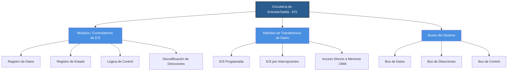

# Mapa Conceptual: Circuitería de Entrada/Salida (E/S)

Este repositorio contiene la estructura y documentación sobre los componentes y funcionamiento de la circuitería de Entrada/Salida en sistemas computacionales.

## Diagrama Conceptual

## Descripción de Componentes

1. **Módulos de E/S:** Interfaz entre la CPU/memoria y uno o más dispositivos periféricos.
2. **Métodos de Transferencia:**
   - **Programada:** La CPU espera activamente a que el dispositivo esté listo (Polling).
   - **Por Interrupciones:** El dispositivo avisa a la CPU cuando necesita atención.
   - **DMA (Direct Memory Access):** La transferencia ocurre directamente entre periférico y memoria sin pasar por la CPU.
3. **Buses:** Líneas físicas encargadas de transportar información, direcciones y señales de sincronización.